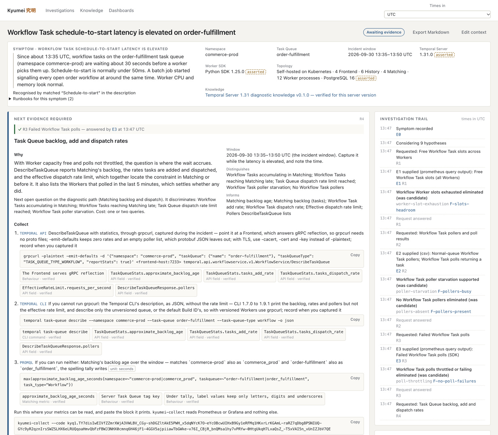
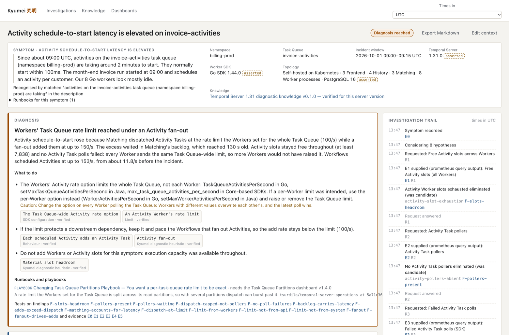
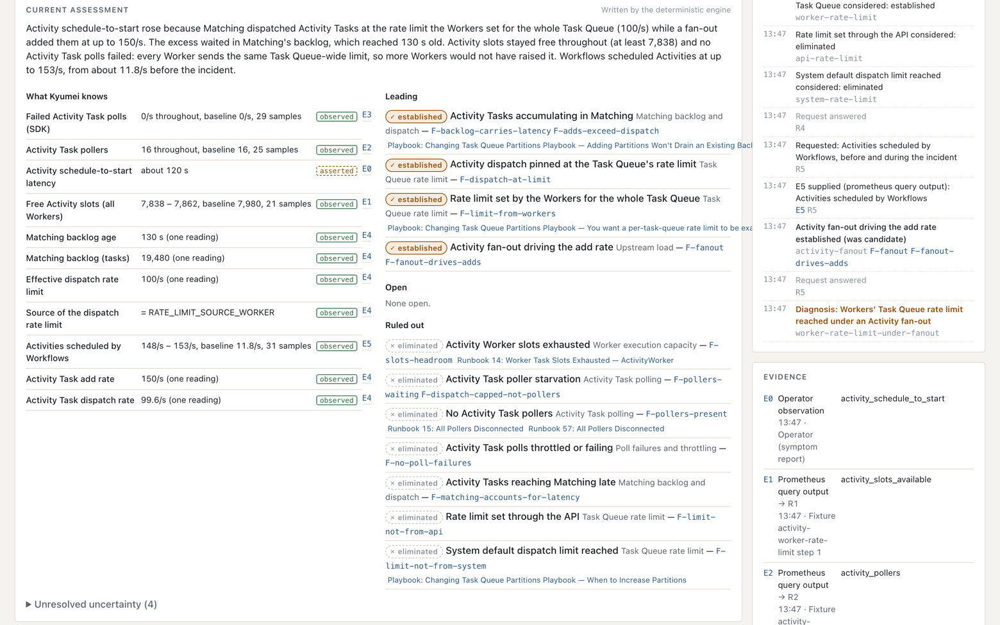
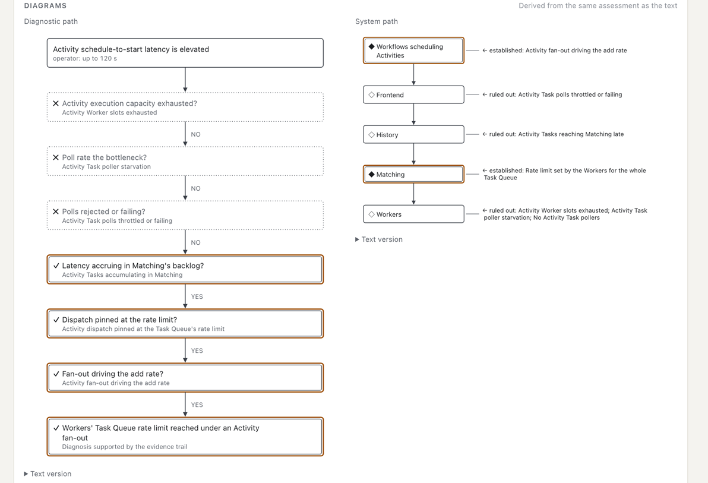

# Kyumei 究明

[](https://github.com/iw/kyumei/actions/workflows/ci.yml)
[](LICENSE)
[](rust-toolchain.toml)
[](#status)
[](#built-with-claude)

Evidence-driven diagnostics for Temporal.

Kyumei helps an operator find out *why* a running Temporal deployment is
misbehaving. It turns each piece of evidence (metrics it reads from your Prometheus
or Grafana, CLI and API output, configuration) into a structured, durable
investigation. It keeps competing hypotheses open and asks for the one piece of
evidence that best tells them apart. It explains exactly how to collect it, reads
the metrics itself where it can, and updates the investigation when the evidence
arrives. Every conclusion can be traced back to the evidence behind it.

It is not a dashboard and not a chatbot. The workspace shows the situation, the
current assessment, the **one next piece of evidence** to collect, and a compact
audit trail.

Kyumei is an independent project, not affiliated with Temporal Technologies, Inc.

```bash
cargo run -p kyumei -- serve --demo 3
```

Then open <http://127.0.0.1:7373/>. `--demo 3` preloads the reference investigation
part-way. The remaining evidence files are in
`fixtures/investigations/signal-flood-wft-latency/evidence/`; paste them into the
workspace to finish the investigation.

## What it does

- **Opens an investigation from a description.** "What are you seeing?" Kyumei
  recognises the symptom, records the description as evidence `E0`, and reads
  quantities like "about 30 seconds" as *operator assertions*. Server version, SDK,
  namespace, Task Queue, window and topology are optional; unknown stays unknown.
- **Asks for one precise piece of evidence at a time.** Each request says what is
  needed, why it matters, and how to collect it. Queries are rendered for your
  scope and your SDK: Core-based, Go or Java, each with its own metric names. The
  request also gives the time window, the grouping, and which hypotheses the
  evidence will discriminate.
- **Ingests evidence without destroying it.** Supported: Prometheus API JSON,
  exposition text, CSV exports, `timestamp value` series, DescribeTaskQueue JSON and
  CLI tables, dynamic-config YAML, logs, screenshots (metadata only), typed values
  and written observations, and Kyumei sample blocks. The raw submission is kept
  byte for byte. Kyumei's reading of it sits beside it and can be corrected
  without touching it.
- **Reads metrics itself, or through a companion.** Started with a Prometheus
  or Grafana endpoint, Kyumei runs a request's queries when you press *Collect
  now*. Where it cannot reach them, `kyumei-collect`, a small read-only binary
  with no model, agents or knowledge, runs the request's code where the metrics
  can be read. It prints a compact, checksummed block of the samples to paste
  back. Values stay exact unless you ask for rounding. See
  [docs/collector.md](docs/collector.md).
- **Reasons deterministically.** A declarative knowledge pack defines signals,
  hypotheses, rules and conclusions. The engine moves hypotheses between
  *candidate, supported, weakened, eliminated* and *established*, with no
  confidence percentages. It uses three-valued logic, so absence of evidence is
  never evidence of absence. Later evidence can revisit earlier hypotheses.
- **Concludes only when the evidence supports it**, and only once no more specific
  diagnosis remains possible. Every finding exposes the facts it rests on, their
  standing (observed, asserted or simulated), their source evidence and the
  knowledge claims used.
- **Checks whether a cause is big enough.** Once the evidence calibrates it,
  Kyumei simulates the cause alone with [tempdes](https://github.com/iw/tempdes)
  and compares the latency it gives with the one observed. The result is a
  simulated fact: it can support or weaken a hypothesis, never settle one. See
  [docs/operator-guide.md](docs/operator-guide.md#simulations).
- **Links runbooks and draws evidence as your dashboards do.** Each diagnosis,
  hypothesis and request links the alert runbooks, playbook sections and
  dashboard panels of
  [tsurdilo/temporal-server-operations](https://github.com/tsurdilo/temporal-server-operations)
  that bear on it, cited at a pinned commit with the versions the repository
  declares. Given your Grafana dashboards, Kyumei draws evidence as the
  matching panel does (its unit, legend and thresholds), opens every linked
  panel with live data from your Prometheus, and checks the panels' queries
  against what it knows about the metrics. See
  [docs/operator-guide.md](docs/operator-guide.md#dashboards-and-runbooks).
- **Reads in your time zone, and starts where you work.** A selector shows
  every time in your zone, UTC by default; a configuration file lists the zones
  to offer and environment profiles that fill in a new investigation, whose
  window starts as the last hour. See
  [docs/operator-guide.md](docs/operator-guide.md#configuration-and-data).
- **Draws diagrams from the same state as the text.** Kyumei derives a diagnostic
  path, a system path and an evidence-relationship graph as a typed IR. It
  validates them and renders them as accessible SVG with text fallbacks. A model
  may propose a diagram type and focus, never its contents.
- **Survives restarts.** Investigations are kept in the data directory: as
  durable workflows on [Odori](#the-explainer-and-odori) by default, or as a JSON
  journal with `--in-process`. Leave for an hour or a day, restart the server,
  and continue where you were.
- **Shows provenance.** Every metric, configuration key, API field and behaviour
  records the Temporal versions it was verified against, with repository, revision,
  path, line and verbatim excerpt. `kyumei knowledge verify` re-checks them against
  local checkouts. Every dynamic configuration setting and server metric of
  Temporal Server 1.27.0 to 1.32.1, and the metrics of the Core, Go and Java
  SDKs, are generated from the source, and each says the releases it holds in.
  Each metric lists every name it can be exported under, by exporter and
  option. There is a knowledge pack for each minor release, and an
  investigation uses the one for its server. The knowledge pages can be
  searched and filtered by kind, verification status and whether a diagnostic
  uses a claim.

## The reference investigation

A batch job signals every open order workflow. Workflow Task schedule-to-start on
`order-fulfillment` climbs to about 30 seconds while Workers have plenty of free
slots. Kyumei:

1. rules out Worker execution capacity (free slots never dropped below 1,071);
2. finds pollers busy, so poller starvation is *supported* rather than ruled out;
3. rules out poll failures and throttling;
4. finds the latency in Matching's backlog (31.4 s) and dispatch pinned at the Task
   Queue's effective rate limit (2,000/s). This rules out poller starvation as the
   binding constraint, *revisiting* step 2;
5. traces the limit to a two-partition override at 1,000 tasks/s per partition;
6. attributes the add rate to the Signal flood (≈34/s → 2,187/s);

and concludes, without ever recommending more Workers:

> Workflow Task schedule-to-start rose because Matching dispatched Workflow Tasks at
> the Task Queue's effective rate limit (2,000/s) while a Signal flood added them at
> up to 2,112/s. The excess waited in Matching's backlog, which reached 31.4 s old —
> the schedule-to-start latency…

See [docs/reference-investigation.md](docs/reference-investigation.md). To replay it with
no model and no server:

```bash
cargo run -p kyumei -- replay
```

Add `--durable` to replay it on Odori workflows instead.

In the browser, `cargo run -p kyumei -- serve --demo 3 --demo-fixture activity-worker-rate-limit`
opens the reference investigation after its first three steps, at the evidence that turns it.
The page shows the symptom, the next request and how to collect it, each instruction with
the claims it rests on, and the trail so far:

<p align="center">
  
</p>

The second investigation is the Activity reference fixture, replayed in full. It ends with a
diagnosis, what to do about it and the findings it rests on; the state of every hypothesis,
with the evidence behind it; and the paths through the diagnostic and through the system:

<p align="center">
  
</p>

<p align="center">
  
</p>

<p align="center">
  
</p>

## Diagnostics and fixtures

Kyumei recognises twelve symptoms. Each has a reference fixture and at least one
branch, replayed step by step with the expected states, findings and next
request after every submission:

| Symptom | Reference fixture | Branches |
| --- | --- | --- |
| Workflow Task schedule-to-start | `signal-flood-wft-latency`: dispatch ceiling under a Signal flood | `worker-saturation`, `poll-throttling`, `signal-flood-uneven-partitions` (1.32) |
| Activity schedule-to-start | `activity-worker-rate-limit`: the Workers' Task Queue-wide rate limit, taken for a per-Worker one, under a fan-out | `activity-api-rate-limit`, `activity-slot-exhaustion`, `activity-worker-rate-limit-cli`, `activity-worker-rate-limit-reported` (1.32) |
| ResourceExhausted rejections | `namespace-rate-limit-surge`: the namespace rate limit under a surge of Starts | `persistence-host-limit` |
| Persistence latency | `persistence-pool-saturation`: History's connection pools full under a load rise | `persistence-database-slow` |
| Workflow Task failures | `nondeterminism-after-deploy`: a deploy that running Workflows cannot replay | `workflow-code-error`, `workflow-task-timeouts` |
| History limits | `history-size-limit`: imports terminated at 50 MiB, their histories filled by Activity results | `history-count-limit`, `history-approaching-limits` |
| Workflow cache misses and replays | `sticky-cache-full`: a campaign surge fills the Go Workers' caches | `sticky-worker-crashes`, `sticky-cache-disabled` |
| History task processing lag | `timer-burst-scheduler`: two million timers due at once saturate History's schedulers | `history-tasks-throttled`, `history-tasks-busy-workflow` |
| History Workflow cache pressure | `history-cache-full`: a tenant's Workflows outgrow History's caches | `history-cache-shard-moves` |
| Shard ownership churn | `history-deploy-churn`: a rolling History deploy moves every shard twice | `history-crash-slow-acquire` |
| Visibility lag and errors | `visibility-es-slow-writes`: an overloaded Elasticsearch leaves lists minutes behind | `visibility-list-rate-limited`, `visibility-es-rejecting-writes`, `visibility-slow-queries` |
| Java Workflow thread exhaustion | `java-signal-handler-threads`: Signal handlers that wait hold every Workflow thread | `java-cache-fills-threads` |

`visibility-collected-blocks` replays the visibility reference investigation with
every answer pasted as a `kyumei-collect` sample block instead of query output.
`activity-worker-rate-limit-cli` answers the Activity reference investigation's
Matching request with the Temporal CLI's JSON first, which leaves the rate limit
open, and then with DescribeTaskQueue through grpcurl. The two 1.32 branches run
on Temporal 1.32, whose DescribeTaskQueue reports whether the rate limiter held
dispatch back.

Replay any of them by name, or preload them into the workspace:

```bash
cargo run -p kyumei -- replay activity-worker-rate-limit
```

```bash
cargo run -p kyumei -- serve --demo 3 --demo-fixture activity-worker-rate-limit --demo-fixture namespace-rate-limit-surge
```

## Workspace

| Crate | Responsibility |
| --- | --- |
| `kyumei-domain` | Pure model: investigations as event logs, evidence, observations, hypotheses, findings, conclusions, provenance, epistemic status |
| `kyumei-knowledge` | Loads and strictly validates versioned knowledge packs; condition language; provenance re-verification |
| `kyumei-evidence` | Ingestion and normalisation; raw evidence preserved; signal binding |
| `kyumei-diagnostics` | The deterministic engine: facts, rules, states, next request, conclusions, explanations, diagram builders |
| `kyumei-diagrams` | Typed diagram IR, validation, SVG and text rendering, time series charts |
| `kyumei-dashboards` | Grafana dashboards: panels, their queries, units, thresholds and legends; cross-checks |
| `kyumei-app` | Commands, the `InvestigationService` port, workspace view model, Markdown export, fixture replay, collection plans |
| `kyumei-odori` | Durable investigation workflow, activities, explanation agent |
| `kyumei-web` | Topcoat interface (the only crate that knows Topcoat), and Collect now |
| `kyumei-samples` | The sample block format and request codes, with no dependency on the rest of Kyumei |
| `kyumei-collect` | The companion: a read-only Prometheus and Grafana client, and the `kyumei-collect` binary |
| `kyumei-sim` | Simulated clusters: tempdes runs scraped as Prometheus scrapes them, the PromQL Kyumei's requests use answered over the scrapes, and the scenario for the "big enough?" check (the only crate that runs tempdes) |
| `kyumei` | The `kyumei` binary |
| `kyumei-extract` | Maintainer tools: generate knowledge claims from Temporal and SDK source (`gen-dc-claims`, `gen-metric-claims`, `gen-sdk-metric-claims`), reading dynamic configuration with tempdes's parser |

Knowledge lives in `knowledge/temporal/1.31/`. Fixtures live in
`fixtures/investigations/`.

## Documentation

- [Operator guide](docs/operator-guide.md): running Kyumei and working an
  investigation.
- [The reference investigation](docs/reference-investigation.md): the Signal-flood
  scenario, step by step.
- [Architecture](docs/architecture.md): crates, the event log, the engine,
  durability on Odori.
- [Knowledge](docs/knowledge.md): pack format, provenance, verification and
  validation.
- [Collecting metrics](docs/collector.md): Collect now, the `kyumei-collect`
  companion, request codes and the sample block format.
- [Decisions and known limitations](docs/decisions.md).
- [Contributing](CONTRIBUTING.md) and the [security policy](SECURITY.md).
- [AGENTS.md](AGENTS.md): guidance for coding agents working in this repository.

## Commands

```bash
kyumei serve [--addr 127.0.0.1:7373] [--data-dir DIR] [--config FILE] [--demo N]
             [--explainer none|claude|codex] [--in-process]
             [--prometheus-url URL] [--grafana-url URL [--grafana-datasource UID]]
             [--dashboards DIR]
kyumei dashboards check DIR
kyumei replay [FIXTURE] [--durable]
kyumei-collect --code CODE [--set NAME=VALUE …] (--url URL | --grafana URL --datasource UID)
               [--round N] [--redact LABEL,…] [--qr]
kyumei-collect encode FILE… --code CODE
kyumei-collect decode [FILE]
kyumei knowledge check
kyumei knowledge verify --source temporal-server-v1.31.0=../temporal --source …
kyumei knowledge updates [--json]
cargo run -p kyumei-extract --bin gen-dc-claims -- ../temporal [--sweep ../temporal-1.27.0 …] \
  [-o knowledge/temporal/1.31/generated/dynamic-config.toml | --check …]
cargo run -p kyumei-extract --bin gen-metric-claims -- ../temporal [--sweep ../temporal-1.27.0 …] \
  [-o knowledge/temporal/1.31/generated/server-metrics.toml | --check …] [--emitters FILE]
cargo run -p kyumei-extract --bin gen-sdk-metric-claims -- --core ../sdk-rust \
  --go "$(go env GOMODCACHE)/go.temporal.io/sdk@v1.44.0" --java ../sdk-java \
  [-o knowledge/temporal/1.31/generated/sdk-metrics.toml | --check …]
```

## The explainer and Odori

Kyumei's explanations are deterministic: the engine writes each one from the
assessment, so the same evidence always reads the same way. The explainer is
optional. With `--explainer claude` or `--explainer codex`, a model rewords the
explanations through the authenticated Claude Code or Codex CLI. Its draft is
checked against the assessment: no new numbers, no unknown findings, no
contradicted hypothesis states. A draft that fails is discarded and the
deterministic text stays.

The explainer runs on [Odori](https://crates.io/crates/odori)
([documentation](https://docs.rs/odori), [source](https://github.com/tokeira/tokeira-odori)),
a minimal Rust agent framework with durable execution, part of the
[Tokeira](https://tokeira.io) project. Odori runs on the
[tokeira engine](https://github.com/tokeira/tokeira), an embeddable durable
execution engine compatible with Temporal, through the Temporal Rust SDK.
`kyumei serve` runs on Odori by default, which gives Kyumei:

- **Durable investigations.** Each investigation is a workflow on the embedded
  engine. Evidence and corrections arrive as workflow updates, the diagnosis runs
  in activities, and the engine snapshots its state, so a restarted server picks
  up every investigation where it was.
- **The explainer**, as an agent child workflow of the investigation, with the
  model's CLI working in an empty sandbox directory.

Without Odori, `kyumei serve --in-process` runs the same investigations in
process, journalled as JSON in the data directory, with the same diagnostics,
evidence and simulations. Its explanations are the deterministic ones, since the
explainer needs Odori.

## Testing

```bash
cargo test --workspace
```

The suite covers:

- the domain;
- the knowledge validator, including rejection of malformed and contradictory
  packs;
- every evidence parser;
- the sample block format: bit-exact round trips, including NaN, infinities,
  gaps and counter resets, and damaged blocks refused with the reason;
- the companion against a stand-in Prometheus, and Collect now through the
  interface;
- the references, validated at load and checked against a checkout;
- dashboards: reading Grafana JSON, the PromQL panels read, units, legends,
  charts, the choice of panel, and the cross-checks;
- all fixtures, replayed with step-by-step expectations, in process and on
  Odori;
- simulated incidents, each with one cause, diagnosed as that cause, and the
  reference investigation's "big enough?" check, in process and on Odori;
- branching, declines, correction-driven revisits and context changes;
- the explanation guard;
- the web interface, driven by real form posts;
- the architectural dependency rules.

On Odori, it runs the reference investigation across an engine restart, with a
validated model explanation. It replays every fixture on one engine and
checks each conclusion survives a restart. It also simulates a crash
between engine snapshots, and submits evidence larger than a gRPC message.

To re-verify every provenance excerpt against local checkouts:

```bash
KYUMEI_VERIFY_SOURCES="temporal-server-v1.31.0=/path/to/temporal;sdk-core-acac9e3f=/path/to/sdk-rust;…" \
  cargo test -p kyumei-knowledge provenance
```

To check that the generated dynamic configuration, server metrics and SDK metrics
still match their sources:

```bash
KYUMEI_TEMPORAL_SOURCE=/path/to/temporal \
  KYUMEI_SDK_SOURCES="core=/path/to/sdk-rust;go=/path/to/sdk-go;java=/path/to/sdk-java" \
  cargo test -p kyumei-extract --test up_to_date
```

With a checkout of tsurdilo/temporal-server-operations at `5a71c36`, these
read its dashboards, draw every fixture's evidence as their panels, and verify
every reference:

```bash
KYUMEI_OPERATIONS_SOURCE=/path/to/temporal-server-operations \
  cargo test -p kyumei-dashboards -p kyumei-app -- --nocapture
```

```bash
cargo run -p kyumei -- knowledge verify \
  --source temporal-server-operations-5a71c36=/path/to/temporal-server-operations
```

To check that sample blocks return real query results exactly (NaN, the
infinities, -0, gaps and counter resets included), point the opt-in test at a
Prometheus:

```bash
KYUMEI_PROMETHEUS_URL=http://127.0.0.1:9090 \
  cargo test -p kyumei-collect --test real_prometheus -- --ignored --nocapture
```

A durable test that hangs never reports, so libtest discards its output. To
keep the engine and worker logs of such a run in a file:

```bash
KYUMEI_TEST_LOG=/tmp/kyumei-durable.log RUST_LOG=kyumei_odori=info,warn \
  cargo test -p kyumei-odori --test durable_golden
```

## Requirements

- Rust 1.98.1 (pinned in `rust-toolchain.toml`; Topcoat needs 1.98).
- Network access to crates.io for the first build, which fetches Odori 0.3, the
  Temporal Rust SDK 1.0 and the tokeira 0.6.1 engine with the other dependencies.
- For `--explainer claude`: Claude Code ≥ 2.1.220, logged in. For
  `--explainer codex`: the Codex CLI, logged in.

## Security

Kyumei has no authentication. Anyone who can reach it can read and change its
investigations and, when it is started with a Prometheus or Grafana endpoint,
have it run its requests' queries with that endpoint's credentials. `kyumei serve`
listens on 127.0.0.1 unless `--addr` says otherwise: run it where only people you
trust can reach it, or behind a proxy that authenticates them. To report a
vulnerability, see [SECURITY.md](SECURITY.md).

## Status

Temporal Server **1.31.0 to 1.31.4**, **1.32.0** and **1.32.1**, with a
knowledge pack for each minor release and the settings and metrics of every
release from 1.27.0 checked by the version sweep; twelve diagnostics (Workflow
Task and Activity schedule-to-start, persistence latency, ResourceExhausted,
Workflow Task failures, history limits, Workflow cache misses, History task
lag, History's Workflow cache, shard ownership churn, visibility lag and
errors, Java Workflow thread exhaustion) and thirty-six fixtures. Kyumei
reads metrics from Prometheus or Grafana when it can reach them, and from
`kyumei-collect` sample blocks when it cannot. Its diagnostics link 98 runbooks,
playbook sections and panels of [tsurdilo/temporal-server-operations](#temporal-server-operations), and it
draws evidence as your Grafana dashboards' panels do. Known limitations, and
the decisions behind Kyumei's design, are in
[docs/decisions.md](docs/decisions.md).

## Temporal server operations

Kyumei's runbooks and dashboard panels come from
[tsurdilo/temporal-server-operations](https://github.com/tsurdilo/temporal-server-operations)
by [@tsurdilo](https://github.com/tsurdilo): playbooks, alert runbooks and Grafana
dashboards for operating self-hosted Temporal. Kyumei's diagnoses, hypotheses and
requests link 98 of its [alert runbooks](https://github.com/tsurdilo/temporal-server-operations/tree/5a71c3656cc0bca831b61142b64c3672cc974b1b/observability/alerts),
[playbook sections](https://github.com/tsurdilo/temporal-server-operations/tree/5a71c3656cc0bca831b61142b64c3672cc974b1b/playbooks) and [dashboard panels](https://github.com/tsurdilo/temporal-server-operations/tree/5a71c3656cc0bca831b61142b64c3672cc974b1b/observability/dashboards),
cited at commit [`5a71c36`](https://github.com/tsurdilo/temporal-server-operations/tree/5a71c3656cc0bca831b61142b64c3672cc974b1b) with the versions the repository declares. Given your
copy of the dashboards, Kyumei draws evidence as the matching panel does and opens each
linked panel with live data from your Prometheus.

The repository has no licence, so Kyumei includes none of its content. It cites and
links each reference, and reads dashboards only from the copy you give it. See
[docs/operator-guide.md](docs/operator-guide.md#dashboards-and-runbooks) and
[THIRD_PARTY_NOTICES.md](THIRD_PARTY_NOTICES.md).

## Built with Claude

Kyumei was built by [Claude](https://www.anthropic.com/claude), the AI model made by
[Anthropic](https://www.anthropic.com), working through
[Claude Code](https://claude.com/claude-code). Claude wrote the Rust workspace, read
Temporal's sources for the knowledge packs and cited every claim to the line it rests
on, and wrote the diagnostics, the fixtures, the tests and the documentation. The
maintainer directs the work, reviews every change, and decides what is committed and
released.

Every commit credits Claude with a `Co-Authored-By` trailer, such as
`Co-Authored-By: Claude Opus 5.5 <noreply@anthropic.com>`, as
[AGENTS.md](AGENTS.md) sets out. [CLAUDE.md](CLAUDE.md) adds the notes that are
Claude's alone.

## Licence

Kyumei is licensed under the [Apache License, Version 2.0](LICENSE). The
knowledge packs quote short excerpts of Temporal's and other projects' sources as
provenance; [THIRD_PARTY_NOTICES.md](THIRD_PARTY_NOTICES.md) names them and their
licences.
